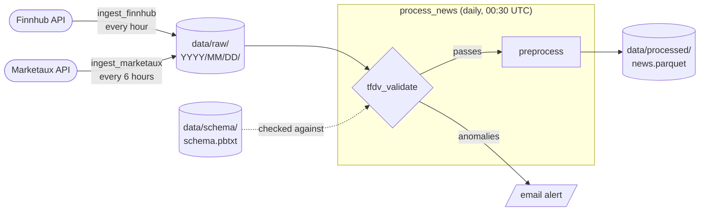

# FinMLOps Data Pipeline

[](https://github.com/FinMLOps/finmlops-data-pipeline/actions/workflows/pytest.yml)

This is the data pipeline for our FinMLOps project. It pulls financial news for the Magnificent 7 (AAPL, MSFT, NVDA, GOOGL, META, AMZN, TSLA) from the Finnhub and Marketaux APIs, checks the raw data with TensorFlow Data Validation, and cleans it into a single Parquet file that we'll later use for sentiment modeling. Airflow runs the whole thing on a schedule inside Docker.

> [!IMPORTANT]
> - We use [`uv`](https://docs.astral.sh/uv/), which is superior to `pip`.
> - Python is pinned to `3.11` (`>=3.11,<3.12`) to ensure compatibility and stability across pipeline dependencies.

## Team

| Name | GitHub | Email |
|---|---|---|
| Nina Gharachorloo | [@ninaghar](https://github.com/ninaghar) | [gharachorloo.ni](mailto:gharachorloo.ni@northeastern.edu) |
| Aayam Raj Shakya | [@aayamrajshakya](https://github.com/aayamrajshakya) | [shakya.aa](mailto:shakya.aa@northeastern.edu) |
| Geethanjali Ravichandra | [@Alpha2505](https://github.com/Alpha2505) | [ravichandra.g](mailto:ravichandra.g@northeastern.edu) |
| Kshitij Maurya | [@kmaurya9](https://github.com/kmaurya9) | [maurya.k](mailto:maurya.k@northeastern.edu) |
| Keshav Girish Adkar | [@KESHAV8087](https://github.com/KESHAV8087) | [adkar.k](mailto:adkar.k@northeastern.edu) |

## How it works



**Ingest** (`scripts/ingest.py`) fetches news for every ticker from both APIs at the same time and saves the responses as-is, one JSONL file per source, under `data/raw/YYYY/MM/DD/`. Files go in the folder of the day the fetch window starts, and we never overwrite raw files. If an API rate limits us or has a server error, the request is retried a few times, and if one source or ticker fails the rest still get saved.

**Validate** (`scripts/tfdv_validate.py`) checks one day of raw data against a saved schema using TFDV. It catches things like missing fields, tickers we don't track, weirdly long text, old or future-dated articles, and days where we got way fewer articles than usual. More details [below](#data-validation).

**Preprocess** (`scripts/preprocess.py`) takes all the raw data and turns it into `data/processed/news.parquet`. It maps the two APIs' different formats to the same columns, strips HTML, converts timestamps to UTC, fixes ticker variants (`MSFT.MI` becomes `MSFT`, `GOOG` becomes `GOOGL`), drops non-English articles, and removes duplicate headlines (keeping the earliest one). Each row is one article for one ticker, so an article about both Apple and Nvidia shows up twice.

## What you need

- **Docker** with Compose (Docker Desktop on Mac/Windows) to run Airflow
- **[uv](https://docs.astral.sh/uv/getting-started/installation/)** if you want to run the scripts or tests outside Docker
- **API keys** for [Finnhub](https://finnhub.io/register) and [Marketaux](https://www.marketaux.com/register), both free
- `make` (already there on Linux and macOS)

### Supported platforms

The only picky dependency is TFDV, which only publishes packages for Linux on x86_64 (glibc 2.39+) and macOS on Apple Silicon. In practice:

| Machine | Airflow in Docker (`make up`) | Scripts and tests with `uv` |
|---|---|---|
| Linux, Intel/AMD (Fedora 40+, Ubuntu 24.04+) | works | works |
| Linux, Intel/AMD, older distro (e.g. Ubuntu 22.04) | works | TFDV won't install (glibc too old) |
| Windows, Intel/AMD | works with Docker Desktop + WSL2 | use WSL2 with Ubuntu 24.04 |
| Mac, Intel | works | TFDV won't install |
| Mac, Apple Silicon (M1 to M4) | probably won't build (no TFDV package for Linux arm64), untested | works |

Everything except `tfdv_validate.py` works anywhere.

> [!WARNING]
> On an Apple Silicon Mac, `make up` will probably fail while installing TFDV. Try adding `platform: linux/amd64` under `x-airflow-common` in `docker-compose.yaml`. It builds the x86_64 image under emulation, which is slow and might not run TensorFlow, so let us know how it goes.

## Quick start (Airflow)

**1. Clone the repo and make your `.env`** (this won't touch an existing one):

```bash
git clone https://github.com/FinMLOps/finmlops-data-pipeline.git
cd finmlops-data-pipeline
[ -f .env ] || cp .env.example .env
```

**2. Add your API keys to `.env`:**

```text
MARKETAUX_API_KEY=your_marketaux_api_key
FINNHUB_API_KEY=your_finnhub_api_key
```

The Gmail settings in there are optional, they're only for email alerts (see [Alerts](#alerts)).

> [!CAUTION]
> `.env` holds your real keys. It's in `.gitignore`, so never force-add it or paste its contents anywhere.

**3. Start Airflow:**

```bash
make up
```

The first build takes a few minutes (it installs TensorFlow), later ones are much faster. When it's done, open http://localhost:8080.

> [!CAUTION]
> The UI has no login since it's only meant to run on your own machine. Don't expose port 8080 to the internet or a shared network.

**4. Turn on the ingestion DAGs** to start collecting. Either flip the toggles next to `ingest_finnhub` and `ingest_marketaux` in the UI, or:

```bash
docker compose exec airflow-scheduler airflow dags unpause ingest_finnhub
docker compose exec airflow-scheduler airflow dags unpause ingest_marketaux
```

They keep collecting as long as Docker is running. Raw files show up in `data/raw/`.

> [!TIP]
> Start collecting as early as possible. The schema baseline, bias slicing and Gantt chart all get better with more days of data.

**5. After the first full day of data, create the schema and turn on processing:**

```bash
uv run python -m scripts.tfdv_validate 2026-10-26 --refresh-schema   # use your first full day
docker compose exec airflow-scheduler airflow dags unpause process_news
```

Look over `data/schema/schema.pbtxt` and commit it. From then on, `process_news` validates each day at 00:30 UTC and rebuilds `data/processed/news.parquet`.

> [!IMPORTANT]
> Build the schema from a full, normal day of data. Every later day is checked against it, so a schema from a partial or test day will flag normal days as anomalies.

**6. Stop Airflow** whenever you want (run history is kept):

```bash
make down
```

> [!CAUTION]
> `docker compose down -v` also deletes the Postgres volume, which wipes all of Airflow's run history. Your files in `data/` are safe either way.

> [!NOTE]
> `make up` runs the containers as your own user, otherwise on Linux the files Airflow writes into the repo would end up owned by someone else. If you don't have `make`, use `AIRFLOW_UID=$(id -u) docker compose up -d --build` instead.

### Other useful Airflow commands

```bash
# run a DAG once right now (from the UI: the play button)
docker compose exec airflow-scheduler airflow dags trigger ingest_finnhub

# run process_news for a specific day without waiting (this one validates 2026-10-25)
docker compose exec airflow-scheduler airflow dags test process_news 2026-10-26T00:30:00+00:00

# see what's running
docker compose ps
```

Task logs are in the UI (click a run, then a task) and also in `logs/`.

## The DAGs

| DAG | File | Schedule | What it does |
|---|---|---|---|
| `ingest_finnhub` | `dags/ingest_news_dag.py` | every hour | fetches that hour's Finnhub news into `data/raw/` |
| `ingest_marketaux` | `dags/ingest_news_dag.py` | every 6 hours (00, 06, 12, 18 UTC) | fetches that 6-hour window's Marketaux news into `data/raw/` |
| `process_news` | `dags/process_news_dag.py` | daily at 00:30 UTC | validates the day that just ended with TFDV, then rebuilds `news.parquet` |

Each ingest run only fetches its own time window, so runs never overlap and there are no gaps. Failed ingest tasks retry twice (5 minutes apart). In `process_news`, preprocessing only runs if validation passes, so bad data never reaches `news.parquet`. Validation doesn't retry, since anomalies won't go away on a retry. If a task still fails after its retries, you get an email (if alerts are set up).

> [!NOTE]
> `process_news` runs at 00:30 instead of midnight so the last ingest runs of the day have time to finish, and it always validates a full day. Validating a partial day would trip the "too few articles" check.

### Why hourly for Finnhub and every 6 hours for Marketaux

We track 7 tickers, and each run makes one request per ticker (Marketaux can take up to 3 pages per ticker), so the schedules come down to each API's free-plan limits:

| | Requests per run | Runs per day | Requests per day | Free plan limit |
|---|---|---|---|---|
| Finnhub, hourly | 7 tickers x 1 = 7 | 24 | 7 x 24 = 168 | ~60 per minute, no daily cap |
| Marketaux, every 6 hours | 7 tickers x up to 3 pages = 21 | 4 | 21 x 4 = 84 at most | ~100 per day |

Finnhub's only limit is per minute, and 7 requests at once is well under 60, so we could run it more often. We don't, because its company news endpoint only filters by date, so every call returns the whole day's articles anyway. Running more than once an hour would mostly re-download the same articles.

Marketaux is the one that's limited. Every 6 hours uses at most 84 of the ~100 daily requests and leaves some room for retries. Running every 4 hours would be 21 x 6 = 126 requests, which is over the limit. In practice we use fewer than 84 because tickers with less news stop after the first page.

> [!WARNING]
> Don't schedule Marketaux more often than every 6 hours. Once the daily limit is hit, every Marketaux request fails with HTTP 429 for the rest of the day, including manual runs.

### How the Docker setup works

- **`Dockerfile`**: we don't use the official Airflow image. It's based on an older Debian, and TFDV 1.21 won't install on it, so we install Airflow on top of `python:3.11-slim-trixie` instead. It's a two-stage build: the first stage builds the pipeline's Python environment (`/opt/venv`, from `uv.lock`) with a compiler, and the final image only copies the result. The pipeline scripts run with that environment, separate from Airflow's, so TFDV and TensorFlow can't mess with Airflow's packages. Downloads are kept in Docker's build cache, so rebuilding after a dependency change takes about a minute instead of three.
- **`docker-compose.yaml`**: Postgres, the scheduler, the API server (the UI), and the DAG processor. The repo is mounted into the containers, so DAGs read and write the real `data/` folder, and `.env` is passed to all of them. Postgres is only there for Airflow's own bookkeeping (DAG runs, task status, history). Our data doesn't go in it.
- **`Makefile`**: `make up` and `make down`.

> [!NOTE]
> The image is about 4 GB, almost all of it TensorFlow.

## Running the scripts yourself (no Airflow)

You can run each step by hand too, which is handy for testing. Install the dependencies first:
```bash
uv sync
```

Then:
```bash
# fetch the last 24 hours for all tickers and both sources
uv run python -m scripts.ingest

# or just some tickers
uv run python -m scripts.ingest AAPL TSLA

# or one source and an exact time window (this is how the DAGs call it)
uv run python -m scripts.ingest --source finnhub --since 2026-10-25T10:00:00+00:00 --until 2026-10-25T11:00:00+00:00

# validate a day of raw data (defaults to today, UTC, so pass a finished day)
uv run python -m scripts.tfdv_validate 2026-10-25

# clean everything in data/raw/ into data/processed/news.parquet
uv run python -m scripts.preprocess
```

> [!CAUTION]
> Every manual ingest run uses API requests from the same daily limits as the DAGs, so running it by hand while the DAGs are on can use up the Marketaux quota.

## Data validation

`tfdv_validate.py` reads a day of raw files, turns each article into a few simple features, and checks them against the schema in `data/schema/schema.pbtxt`:

| Feature | What we check |
|---|---|
| `source` | required, must be `finnhub` or `marketaux` |
| `symbol` | required, must be one of our tickers, and the mix of tickers shouldn't shift too much from the day before |
| `title_len` | required, can't be empty, flagged if over 3x the longest title in the baseline, and checked for drift |
| `published_hour` | required, 0 to 23 |
| `age_days` | how old the article is compared to the day we're validating, must be 0 to 7 |
| `summary_len` | optional, flagged if over 3x the baseline max, and checked for drift |
| `n_symbols` | optional, flagged if over 3x the baseline max |
| `has_url`, `publisher` | optional, we keep `publisher` for bias slicing later |
| number of articles | flagged if we got less than half the articles of the last validated day (usually means an API quietly failed). Validate full days only, a partial day will trip this |

Lines it can't read (bad JSON, no timestamp, unknown source) get skipped and counted. Every run saves the stats, any anomalies, a JSON report and an HTML stats page to `data/validation/YYYY/MM/DD/`. The HTML page needs internet to load. If anything looks wrong it raises an error, so the Airflow task fails, and when you run it from the terminal it also sends an email alert.

> [!TIP]
> Open `data/validation/YYYY/MM/DD/stats.html` in a browser for a visual overview of the day's data. It's useful for screenshots in the report.

Our schema is built from two full weeks of real data (12 to 23 Oct 2026), so normal weekday variety (long summaries, market roundups that mention dozens of tickers) doesn't get flagged. It stays the same until we rebuild it on purpose:
```bash
uv run python -m scripts.tfdv_validate --baseline 2026-10-12 2026-10-23   # every day from START to END
```
Look over the diff and commit it. If there's no schema at all, the first validation run creates one from that single day instead (`--refresh-schema` forces that too), but a range of normal days makes a much better baseline.

## Alerts

`scripts/alert_utils.py` sends alert emails through Gmail when:
- TFDV validation finds anomalies or there's no raw data for the day
- any Airflow task fails after all its retries

To turn it on, add these to your `.env` (the Gmail account needs an [app password](https://myaccount.google.com/apppasswords), not your normal password):

```text
GMAIL_USERNAME=bot@gmail.com
GMAIL_APP_PASSWORD=abcd efgh ijkl mnop
ALERT_RECIPIENTS=a@x.com,b@x.com
```

If they're blank, alerts are just skipped with a warning and everything else still runs. If sending fails, that gets logged but the original error still comes through.

> [!IMPORTANT]
> The CI failure email uses GitHub secrets, which only GitHub Actions can see. The pipeline can't read those, so you need to put the Gmail settings in your own `.env` too.

## Data versioning (DVC)

We version `data/raw/` and `data/processed/news.parquet` with DVC. The `preprocess` step is a DVC stage in `dvc.yaml`, so `dvc.lock` records exactly which raw data and code produced each `news.parquet`. To record the current data as a new version:
```bash
make snapshot
```

The data is stored in a Google Cloud Storage bucket (`gs://finmlops-pipeline-dvc`) in our teammate Kshitij's personal Google Cloud account, since the Google Cloud access from our university accounts came with too many restrictions. If you have access, `uv run dvc pull` gets you every version we've snapshotted. See [docs/dvc_guide.md](docs/dvc_guide.md) for setup, everyday commands and troubleshooting.

## Tests

```bash
uv run pytest                              # everything
uv run pytest tests/test_preprocess.py     # or one file
```

> [!NOTE]
> The tests don't hit any APIs or send real emails, those are all mocked, so they're free to run as often as you like. CI runs them on every push and PR to `main`.

## Project structure

```text
finmlops-data-pipeline/
├── .github/workflows/
│   ├── pytest.yml            # runs the tests in CI
│   └── claude.yml            # Claude PR review assistant
├── dags/
│   ├── ingest_news_dag.py    # ingestion DAGs (Finnhub hourly, Marketaux every 6 hours)
│   └── process_news_dag.py   # daily validate + preprocess
├── data/
│   ├── raw/                  # raw API responses by date (not in git)
│   ├── processed/            # news.parquet (not in git)
│   ├── schema/               # TFDV schema (in git)
│   └── validation/           # TFDV stats and reports by date (not in git)
├── docs/
│   ├── dvc_guide.md          # DVC setup (GCS bucket) and commands
│   └── submission_checklist.md # where each rubric point is covered in the repo
├── logs/                     # Airflow task logs (not in git)
├── scripts/
│   ├── config.py             # the tickers we track
│   ├── ingest.py             # fetches news and saves raw JSONL
│   ├── tfdv_validate.py      # TFDV checks on raw data
│   ├── preprocess.py         # cleans raw data into Parquet
│   ├── alert_utils.py        # email alerts (validation + Airflow failures)
│   ├── fetch_finnhub.py      # Finnhub API
│   ├── fetch_marketaux.py    # Marketaux API
│   └── helpers/
│       ├── base.py           # shared API code (keys, retries, hiding keys in logs)
│       └── schemas.py        # data classes and date parsing
├── tests/                    # one test file per script
├── Dockerfile                # Airflow image with our dependencies
├── docker-compose.yaml       # local Airflow setup
├── Makefile                  # make up / make down / make snapshot
├── dvc.yaml                  # DVC pipeline stage (preprocess)
├── dvc.lock                  # exact data versions from the last DVC run
├── .env.example              # template for .env
├── pyproject.toml
└── uv.lock
```
