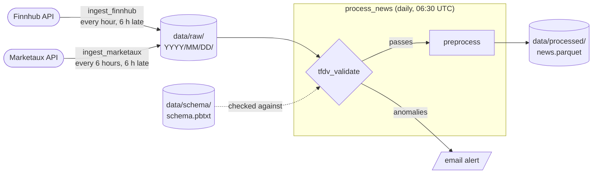

# FinMLOps Data Pipeline

[](https://github.com/FinMLOps/finmlops-data-pipeline/actions/workflows/pytest.yml)

This is the data pipeline for our FinMLOps project. It pulls financial news for the Magnificent 7 (AAPL, MSFT, NVDA, GOOGL, META, AMZN, TSLA) from the Finnhub and Marketaux APIs, checks the raw data with TensorFlow Data Validation, and cleans it into a single Parquet file that we'll later use for sentiment modeling. Airflow runs the whole thing on a schedule inside Docker.

> [!IMPORTANT]
> - We use [`uv`](https://docs.astral.sh/uv/), which is superior to `pip`.
> - Python is pinned to `3.11` (`>=3.11,<3.12`) to ensure compatibility and stability across pipeline dependencies.

## Team

| Name | GitHub | Email |
|---|---|---|
| Nina Gharachorloo | [@ninaghar](https://github.com/ninaghar) | [gharachorloo.ni](mailto:gharachorloo.ni@northeastern.edu) |
| Aayam Raj Shakya | [@aayamrajshakya](https://github.com/aayamrajshakya) | [shakya.aa](mailto:shakya.aa@northeastern.edu) |
| Geethanjali Ravichandra | [@Alpha2505](https://github.com/Alpha2505) | [ravichandra.g](mailto:ravichandra.g@northeastern.edu) |
| Kshitij Maurya | [@kmaurya9](https://github.com/kmaurya9) | [maurya.k](mailto:maurya.k@northeastern.edu) |
| Keshav Girish Adkar | [@KESHAV8087](https://github.com/KESHAV8087) | [adkar.k](mailto:adkar.k@northeastern.edu) |

## How it works



**Ingest** (`scripts/ingest.py`) fetches news for every ticker from both APIs at the same time and saves the responses as-is, one JSONL file per source, under `data/raw/YYYY/MM/DD/`. Each run fetches a window that ended 6 hours earlier, because the APIs take a few hours to make new articles available (see [docs/PIPELINE.md](docs/PIPELINE.md#why-each-run-fetches-6-hours-late)). Files go in the folder of the day the fetch window starts, and we never overwrite raw files. If an API rate limits us or has a server error, the request is retried a few times, and if one source or ticker fails the rest still get saved.

**Validate** (`scripts/tfdv_validate.py`) checks one day of raw data against a saved schema using TFDV. It catches things like missing fields, tickers we don't track, weirdly long text, old or future-dated articles, and days where we got way fewer articles than usual. More details in [docs/PIPELINE.md](docs/PIPELINE.md#data-validation).

**Preprocess** (`scripts/preprocess.py`) takes all the raw data and turns it into `data/processed/news.parquet`. It maps the two APIs' different formats to the same columns, strips HTML, converts timestamps to UTC, fixes ticker variants (`MSFT.MI` becomes `MSFT`, `GOOG` becomes `GOOGL`), drops non-English articles, and removes duplicate headlines (keeping the earliest one). Each row is one article for one ticker, so an article about both Apple and Nvidia shows up twice.

## More docs

| Page | What's in it |
|---|---|
| [docs/SETUP.md](docs/SETUP.md) | what you need, supported platforms, `.env` settings, keeping the computer awake, Airflow commands, how the Docker setup works, running each script by hand |
| [docs/PIPELINE.md](docs/PIPELINE.md) | DAG schedules and why, why each run fetches 6 hours late, every validation check, the schema baseline, alerts |
| [docs/DVC_GUIDE.md](docs/DVC_GUIDE.md) | DVC setup with our GCS bucket, everyday commands, troubleshooting |
| [docs/SUBMISSION_CHECKLIST.md](docs/SUBMISSION_CHECKLIST.md) | where each point of the course rubric is covered |

## Quick start (Airflow)

You need Docker with Compose, `make`, and free API keys for [Finnhub](https://finnhub.io/register) and [Marketaux](https://www.marketaux.com/register). For running the scripts and tests outside Docker you also need [uv](https://docs.astral.sh/uv/getting-started/installation/).

> [!WARNING]
> Not every machine can install TFDV. Linux x86_64 and Windows with WSL2 work; Apple Silicon Macs probably can't build the Docker image. Check [supported platforms](docs/SETUP.md#supported-platforms) first.

**1. Clone the repo and make your `.env`** (this won't touch an existing one):

```bash
git clone https://github.com/FinMLOps/finmlops-data-pipeline.git
cd finmlops-data-pipeline
[ -f .env ] || cp .env.example .env
```

**2. Add your API keys to `.env`:**

```text
MARKETAUX_API_KEY=your_marketaux_api_key
FINNHUB_API_KEY=your_finnhub_api_key
```

The Gmail settings in there are optional, they're only for alert emails (see [SETUP.md](docs/SETUP.md#the-env-file)).

> [!CAUTION]
> `.env` holds your real keys. It's in `.gitignore`, so never force-add it or paste its contents anywhere.

**3. Start Airflow:**

```bash
make up
```

The first build takes a few minutes (it installs TensorFlow), later ones are much faster. When it's done, open http://localhost:8080.

> [!CAUTION]
> The UI has no login since it's only meant to run on your own machine. Don't expose port 8080 to the internet or a shared network.

**4. Turn on the DAGs.** Either flip the toggles next to the three DAGs in the UI, or:

```bash
docker compose exec airflow-scheduler bash -c 'for d in ingest_finnhub ingest_marketaux process_news; do airflow dags unpause $d; done'
```

The ingest DAGs start collecting into `data/raw/`, and `process_news` validates and cleans each day at 06:30 UTC the next morning. The schema is already in the repo (`data/schema/schema.pbtxt`), so there's nothing to set up for validation.

> [!IMPORTANT]
> Airflow only runs while your computer is on and awake, so keep it awake (and plugged in), especially around 06:00 to 06:30 UTC when each day gets finished and processed. See [keeping the computer awake](docs/SETUP.md#keeping-the-computer-awake).

**5. Stop Airflow** whenever you want (run history is kept):

```bash
make down
```

> [!CAUTION]
> `docker compose down -v` also deletes the Postgres volume, which wipes all of Airflow's run history. Your files in `data/` are safe either way.

> [!NOTE]
> `make up` runs the containers as your own user, otherwise on Linux the files Airflow writes into the repo would end up owned by someone else. If you don't have `make`, use `AIRFLOW_UID=$(id -u) docker compose up -d --build` instead.

More commands (triggering a DAG, running one day by hand, running the scripts without Airflow) are in [docs/SETUP.md](docs/SETUP.md#useful-airflow-commands).

## The DAGs

| DAG | Schedule (UTC) | What it does |
|---|---|---|
| `ingest_finnhub` | every hour | fetches one hour of Finnhub news, 6 hours late |
| `ingest_marketaux` | every 6 hours | fetches one 6-hour window of Marketaux news, 6 hours late |
| `process_news` | daily at 06:30 | validates the previous day with TFDV, then rebuilds `news.parquet` |

Each run fetches its own time window, so runs never overlap and there are no gaps, and missed windows are caught up when Airflow comes back. Preprocessing only runs if validation passes. The schedule maths, the retries and why each run is 6 hours late are in [docs/PIPELINE.md](docs/PIPELINE.md#the-dags).

## Data validation

Every day is checked with TFDV against the schema in `data/schema/schema.pbtxt` (built from two weeks of real data) and compared with the same weekday a week earlier. It catches missing fields, tickers we don't track, outliers, old or future-dated articles, non-English articles, drift in the ticker mix, too few or too many articles, a missing source or ticker, and duplicate spikes. Each day's stats, anomalies and an HTML stats page go to `data/validation/YYYY/MM/DD/`. The full list of checks is in [docs/PIPELINE.md](docs/PIPELINE.md#data-validation).

## Alerts

When validation finds anomalies or any Airflow task fails after its retries, the team gets an email (through Gmail, set up in `.env`). Failing tests in CI send their own email. What each email contains is in [docs/PIPELINE.md](docs/PIPELINE.md#alerts).

## Data versioning (DVC)

We version `data/raw/` and `data/processed/news.parquet` with DVC. The `preprocess` step is a DVC stage in `dvc.yaml`, so `dvc.lock` records exactly which raw data and code produced each `news.parquet`. To record the current data as a new version:
```bash
make snapshot
git push
```

The data is stored in a Google Cloud Storage bucket (`gs://finmlops-pipeline-dvc`) in our teammate Kshitij's personal Google Cloud account, since the Google Cloud access from our university accounts came with too many restrictions. If you have access, `uv run dvc pull` gets you every version we've snapshotted. See [docs/DVC_GUIDE.md](docs/DVC_GUIDE.md) for setup, everyday commands and troubleshooting.

## Tests

```bash
uv run pytest                              # everything
uv run pytest tests/test_preprocess.py     # or one file
```

> [!NOTE]
> The tests don't hit any APIs or send real emails, those are all mocked, so they're free to run as often as you like. CI runs them on every push and PR to `main`.

## Project structure

```text
finmlops-data-pipeline/
├── .github/workflows/
│   ├── pytest.yml            # runs the tests in CI
│   └── claude.yml            # Claude PR review assistant
├── dags/
│   ├── ingest_news_dag.py    # ingestion DAGs (Finnhub hourly, Marketaux every 6 hours)
│   └── process_news_dag.py   # daily validate + preprocess
├── data/
│   ├── raw/                  # raw API responses by date (not in git)
│   ├── processed/            # news.parquet (not in git)
│   ├── schema/               # TFDV schema (in git)
│   └── validation/           # TFDV stats and reports by date (not in git)
├── docs/
│   ├── SETUP.md              # setup details and running things by hand
│   ├── PIPELINE.md           # schedules, validation checks and alerts in detail
│   ├── DVC_GUIDE.md          # DVC setup (GCS bucket) and commands
│   └── SUBMISSION_CHECKLIST.md # where each rubric point is covered in the repo
├── logs/                     # Airflow task logs (not in git)
├── scripts/
│   ├── config.py             # the tickers we track
│   ├── ingest.py             # fetches news and saves raw JSONL
│   ├── tfdv_validate.py      # TFDV checks on raw data
│   ├── preprocess.py         # cleans raw data into Parquet
│   ├── alert_utils.py        # email alerts (validation + Airflow failures)
│   ├── fetch_finnhub.py      # Finnhub API
│   ├── fetch_marketaux.py    # Marketaux API
│   └── helpers/
│       ├── base.py           # shared API code (keys, retries, hiding keys in logs)
│       └── schemas.py        # data classes and date parsing
├── tests/                    # one test file per script
├── Dockerfile                # Airflow image with our dependencies
├── docker-compose.yaml       # local Airflow setup
├── Makefile                  # make up / make down / make snapshot
├── dvc.yaml                  # DVC pipeline stage (preprocess)
├── dvc.lock                  # exact data versions from the last DVC run
├── .env.example              # template for .env
├── pyproject.toml
└── uv.lock
```
