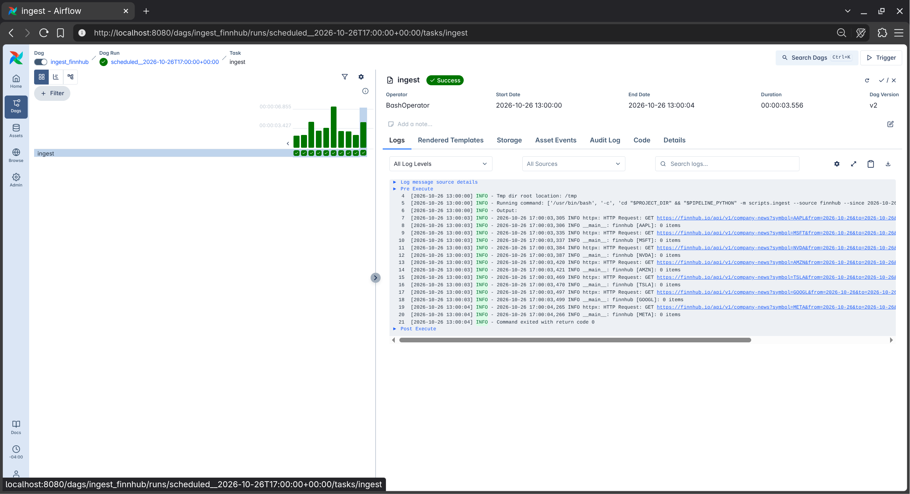

# How the pipeline works, in detail

The [README](../README.md#how-it-works) has the overview. This page explains the DAG schedules, why each run fetches 6 hours late, what validation checks, and what the alerts look like.

## The DAGs

| DAG | File | Schedule | What it does |
|---|---|---|---|
| `ingest_finnhub` | `dags/ingest_news_dag.py` | every hour | fetches one hour of Finnhub news, 6 hours late (the 12:00 run fetches 05:00 to 06:00) |
| `ingest_marketaux` | `dags/ingest_news_dag.py` | every 6 hours (00, 06, 12, 18 UTC) | fetches one 6-hour window of Marketaux news, 6 hours late (the 12:00 run fetches 00:00 to 06:00) |
| `process_news` | `dags/process_news_dag.py` | daily at 06:30 UTC | validates the previous day with TFDV, then rebuilds `news.parquet` |

- Each ingest run only fetches its own `[start, end)` time window, so runs never overlap and there are no gaps. An article published exactly at the end of a window belongs to the next one.
- If the machine was off, `catchup` runs the missed windows when Airflow comes back.
- Failed ingest tasks retry twice (5 minutes apart).
- In `process_news`, preprocessing only runs if validation passes, so bad data never reaches `news.parquet`. Validation doesn't retry, since anomalies won't go away on a retry.
- If a task still fails after its retries, you get an email (if alerts are set up).

> [!NOTE]
> Because ingest runs 6 hours late, the last windows of a day (Finnhub 23:00 to 24:00, Marketaux 18:00 to 24:00) are only fetched at 06:00 the next morning. `process_news` runs at 06:30 so those are in, and it always validates a full day. Validating a partial day would trip the "too few articles" check.

### Why each run fetches 6 hours late

At first every run fetched the window that had just ended (the 10:00 run fetched 09:00 to 10:00). The Finnhub files looked suspiciously small, so on 26 Oct we fetched the same hours again later in the day and compared:

| | Articles for 09:00 to 16:00 UTC, 26 Oct |
|---|---|
| fetched hourly, right after each hour ended | 26 |
| fetched again a few hours later | 338 |



*The 17:00 UTC Finnhub run on 26 Oct, before the fix: it fetched 16:00 to 17:00, noon on a Monday in New York, and found 0 articles for all 7 tickers.*

So the hourly runs were only getting about 8% of the articles. Finnhub (and probably Marketaux) makes articles available a few hours after they're published, and since each run only asks for its own window, the late ones were never picked up. Now each run fetches the window that ended 6 hours ago, which is about twice the delay we saw.

### Why hourly for Finnhub and every 6 hours for Marketaux

We track 7 tickers, and each run makes one request per ticker (Marketaux can take up to 3 pages per ticker), so the schedules come down to each API's free-plan limits:

| | Requests per run | Runs per day | Requests per day | Free plan limit |
|---|---|---|---|---|
| Finnhub, hourly | 7 tickers x 1 = 7 | 24 | 7 x 24 = 168 | ~60 per minute, no daily cap |
| Marketaux, every 6 hours | 7 tickers x up to 3 pages = 21 | 4 | 21 x 4 = 84 at most | ~100 per day |

Finnhub's only limit is per minute, and 7 requests at once is well under 60, so we could run it more often. We don't, because its company news endpoint only filters by date, so every call returns the whole day's articles anyway. Running more than once an hour would mostly re-download the same articles.

Marketaux is the one that's limited. Every 6 hours uses at most 84 of the ~100 daily requests and leaves some room for retries. Running every 4 hours would be 21 x 6 = 126 requests, which is over the limit. In practice we use fewer than 84 because tickers with less news stop after the first page.

> [!WARNING]
> Don't schedule Marketaux more often than every 6 hours. Once the daily limit is hit, every Marketaux request fails with HTTP 429 for the rest of the day, including manual runs.

## Data validation

`scripts/tfdv_validate.py` reads a day of raw files, turns each article into a few simple features, and checks them against the schema in `data/schema/schema.pbtxt`:

| Feature | What we check |
|---|---|
| `source` | required, must be `finnhub` or `marketaux` |
| `symbol` | required, must be one of our tickers, and the mix of tickers shouldn't shift too much from the same weekday a week earlier |
| `title_len` | required, can't be empty, flagged if over 3x the longest title in the baseline, and checked for drift |
| `published_hour` | required, 0 to 23 |
| `age_days` | how old the article is compared to the day we're validating, must be 0 to 7 |
| `summary_len` | optional, flagged if over 3x the baseline max, and checked for drift |
| `n_symbols` | optional, flagged if over 3x the baseline max |
| `has_url`, `publisher` | optional, we keep `publisher` to see where our news comes from |
| `language` | must be `en` |
| number of articles | flagged if we got less than half (or more than 3x) the articles of the same weekday a week earlier (usually means an API quietly failed). Validate full days only, a partial day will trip this |

On top of the schema, a few checks TFDV can't express: a source or ticker with no articles at all, one source dropping by half on its own, and more than 60% of a source's articles repeating a URL.

Lines it can't read (bad JSON, no timestamp, unknown source) get skipped and counted. Every run saves the stats, any anomalies, a JSON report and an HTML stats page to `data/validation/YYYY/MM/DD/`. The HTML page needs internet to load. If anything looks wrong it raises an error, so the Airflow task fails, and when you run it from the terminal it also sends an email alert.

> [!TIP]
> Open `data/validation/YYYY/MM/DD/stats.html` in a browser for a visual overview of the day's data. It's useful for screenshots in the report.

### Why the same weekday a week earlier

Weekends get about a third of the weekday news. When we compared each day with the day before, every Saturday got flagged for low volume and Mondays for a spike. Comparing Saturday with last Saturday got rid of those false alarms. The first week after a fresh setup has nothing to compare with, so the drift and volume checks only start after that.

### The schema baseline

Our schema is built from two full weeks of real data (12 to 23 Oct 2026), so normal weekday variety (long summaries, market roundups that mention dozens of tickers) doesn't get flagged. It stays the same until we rebuild it on purpose:
```bash
uv run python -m scripts.tfdv_validate --baseline 2026-10-12 2026-10-23   # every day from START to END
```
Look over the diff and commit it. If there's no schema at all, the first validation run creates one from that single day instead (`--refresh-schema` forces that too), but a range of normal days makes a much better baseline.

## Alerts

`scripts/alert_utils.py` sends alert emails through Gmail (set up in `.env`, see [SETUP.md](SETUP.md#the-env-file)) when:
- TFDV validation finds anomalies or there's no raw data for the day
- any Airflow task fails after all its retries

The Airflow failure email comes from "FinMLOps Airflow" and lists the DAG, task, data window, attempt, the error, and the last lines the task printed, so you can usually see what went wrong without opening Airflow. It also has a link to the full log, but that only opens on the machine running Airflow.

If sending fails, that gets logged but the original error still comes through, so a broken alert never hides the real problem.

Failing tests in CI send their own email from GitHub Actions (`.github/workflows/pytest.yml`), with the branch, pull request, commit and a link to the run.
