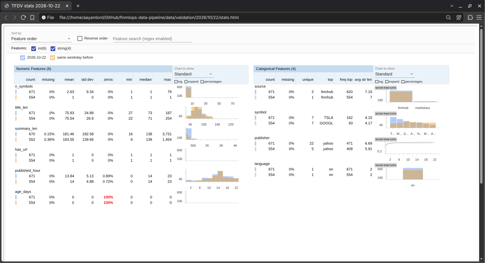
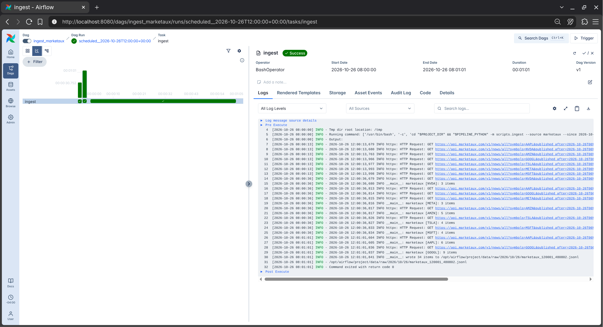
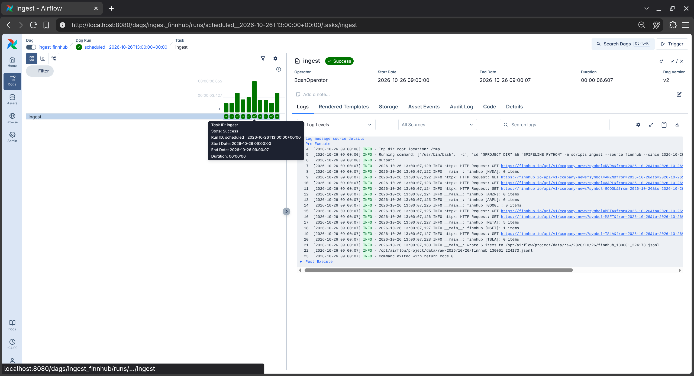

# How we covered the data pipeline rubric

We went through the data pipeline submission guidelines one point at a time and wrote down where each part lives in our repo. If you want to actually set things up and run them, the [README](../README.md) has all the steps.

> [!NOTE]
> All paths are from the root of the repo. Our GitHub org keeps the model in a separate repo, so this whole repo is the data pipeline and we didn't add an extra `Data-Pipeline/` folder.

## 2. Key components

### 2.1 Data acquisition

We get our news from two free APIs, Finnhub and Marketaux, for the 7 tickers we track (the Magnificent 7). Every response is saved exactly the way the API sent it, so we always have the original data to go back to.

| What | Where |
|---|---|
| Getting news from Finnhub (one request per ticker) | `scripts/fetch_finnhub.py` |
| Getting news from Marketaux (one request per ticker, up to 3 pages) | `scripts/fetch_marketaux.py` |
| Code both APIs share: reading keys from `.env`, retrying with backoff on 429/5xx errors, hiding keys in logs | `scripts/helpers/base.py` |
| Fetching all sources and tickers at the same time and saving the raw responses | `scripts/ingest.py` → `data/raw/YYYY/MM/DD/<source>_<time>.jsonl` |
| The list of tickers | `scripts/config.py` |
| Dependencies | `pyproject.toml` and `uv.lock` (we use uv, which pins exact versions like a `requirements.txt` would), plus the `Dockerfile` for Airflow |
| Template for the API keys | `.env.example` |

To keep it reproducible, every run fetches one exact time window (`--since` and `--until`), so running the same window again gets the same articles. Raw files are also never overwritten.

### 2.2 Data preprocessing

Since we get our data from APIs and don't collect it by hand, it already comes in pretty clean, so we had very little cleaning to do. We still wrote a preprocessing step to strip HTML tags, decode HTML entities (like `&amp;` → `&`) and collapse extra whitespace, just to be safe. When we ran it on all our raw data so far, it only changed 6 out of 297 records (2%), and all 6 were HTML entities. There were no HTML tags, no messy whitespace, no empty titles, and every article was already in English.

Most of the actual work in preprocessing is getting both APIs into the same format and deciding what one row means. Everything is in `scripts/preprocess.py`:

| Step | Function |
|---|---|
| Read all the raw files, skipping (and logging) any broken lines | `load_raw()` |
| Turn each API's fields into one common format | `finnhub_row()`, `marketaux_row()` and `make_row()`, picked through `MAPPERS` |
| Strip tags, decode entities, collapse whitespace | `clean_text()` |
| Standardize tickers (`MSFT.MI` → `MSFT`, `GOOG` → `GOOGL`) and drop the ones we don't track | `to_tickers()` |
| Convert times to UTC, drop empty or non-English articles, make one row per article per ticker, remove duplicate headlines (keeping the earliest one), and build the `text` column (title + summary) for the model | `preprocess()` |
| Save everything to `data/processed/news.parquet` | `run()` |

If we ever add another API, we only need to write one new `*_row()` function and add it to `MAPPERS`.

### 2.3 Test modules

We have 75 tests using pytest. None of them call the real APIs or send real emails (we mock those with `respx` and a fake SMTP server), so they're free to run as often as we want. GitHub Actions runs them on every push and PR to `main` (`.github/workflows/pytest.yml`).

| File | Tests | What they check |
|---|---|---|
| `tests/test_preprocess.py` | 12 | mapping fields for each API, HTML cleanup, standardizing tickers, dropping bad records, one row per ticker, keeping the earliest duplicate, broken raw lines, our old raw format, no raw data at all |
| `tests/test_tfdv_validate.py` | 29 | building the schema from several days, comparing with the same weekday, schema domains, bad values, unknown tickers or sources, outliers, stale and future articles, ticker drift, too few or too many articles, a missing source or ticker, one source dropping by half, duplicate spikes, non-English articles, corrupt lines, a missing day |
| `tests/test_ingest.py` | 10 | saving raw data as received, one source failing while the other still works, missing API keys, every request failing, never overwriting files, retrying 5xx but not 4xx, CLI options, date folders |
| `tests/test_schemas.py` | 9 | parsing timestamps and converting them to UTC, IDs, the article data classes |
| `tests/test_finnhub.py` | 5 | missing key, a normal fetch, HTTP errors, invalid JSON, window boundaries |
| `tests/test_marketaux.py` | 5 | missing key, a normal fetch, pagination, HTTP errors, keeping earlier pages when a later page fails |
| `tests/test_alert_utils.py` | 5 | email sent or skipped, a broken email never crashes anything, what the Airflow failure email contains (with and without the task log) |

### 2.4 Pipeline orchestration (Airflow DAGs)

We have three DAGs:

| DAG | File | Runs (UTC) | Tasks |
|---|---|---|---|
| `ingest_finnhub` | `dags/ingest_news_dag.py` | every hour | `ingest`, which fetches one hour, 6 hours late |
| `ingest_marketaux` | `dags/ingest_news_dag.py` | every 6 hours | `ingest`, which fetches one 6-hour window, 6 hours late |
| `process_news` | `dags/process_news_dag.py` | every day at 06:30 | `tfdv_validate` >> `preprocess` |

- Every run fetches a window that ended 6 hours earlier. When we compared the hourly runs with fetching the same hours again later, they had only gotten 26 of 338 articles (about 8%), because the APIs make new articles available a few hours after they're published. `process_news` runs at 06:30 so the day's last windows are in first.
- Every run gets its own `[start, end)` time window from `CronDataIntervalTimetable`. With `catchup=True`, if the laptop running Airflow was asleep, Airflow goes back and runs the windows it missed.
- `preprocess` only runs if validation passed, so bad data never makes it into `news.parquet`.
- Ingest retries twice, 5 minutes apart. Validation doesn't retry, since bad data won't fix itself on a retry.
- Airflow runs in Docker (`Dockerfile`, `docker-compose.yaml`), and `make up` / `make down` start and stop it.

### 2.5 Data versioning with DVC

| What | Where |
|---|---|
| Pointer to the raw data | `data/raw.dvc` |
| The preprocess stage (its inputs, script and output) | `dvc.yaml` |
| The exact data versions from the last run | `dvc.lock` |
| Shared DVC settings | `.dvc/config` |
| One command to take a snapshot (`dvc add` → `dvc repro` → `dvc push` → commit the pointer files) | `make snapshot` in the `Makefile` |
| How to set it up and use it | `docs/dvc_guide.md` |

> [!NOTE]
> Our DVC remote is a Google Cloud Storage bucket (`gs://finmlops-pipeline-dvc/dvc`) in our teammate Kshitij's personal Google Cloud account, so everyone on the team can push and pull the same data. We went with a personal account because the Google Cloud access from our university accounts came with a lot of settings and restrictions. Before we had the bucket we used a local folder as the remote.

### 2.6 Tracking and logging

- All our scripts use Python's `logging` (`ingest.py`, `fetch_marketaux.py`, `helpers/base.py`, `preprocess.py`, `tfdv_validate.py`, `alert_utils.py`). They log how many articles came in per source and ticker, retries, skipped records, files written and any anomalies.
- Airflow saves a log for every task attempt in `logs/`, and you can read them in the UI.
- When something fails, the team gets an email (see 2.8).

### 2.7 Data schema and statistics generation

We used TFDV for this, in `scripts/tfdv_validate.py`. The `tfdv_validate` task runs it every day.

- **Schema:** `data/schema/schema.pbtxt`. We first made it from a single day (24 Oct 2026, 274 articles), but once we had a month of data that turned out to be too narrow: normal weekday articles with long summaries or lots of tickers got flagged as outliers. So we rebuilt it from two full weeks (12 to 23 Oct, 6,020 articles) with `--baseline 2026-10-12 2026-10-23` and committed it to git, so every later day gets checked against the same thing. `infer_schema()` adds allowed values, required fields and ranges on top of what TFDV infers.
- **Statistics:** each day's stats, anomalies, a JSON report and an HTML stats page are saved to `data/validation/YYYY/MM/DD/`.
- **Over time:** each day is compared with the same weekday a week earlier to catch drift (L-infinity distance for categories, Jensen-Shannon for numbers) and big changes in how many articles we got. We started by comparing with the day before, but after backfilling a month of data every Saturday got flagged for low volume and every Monday for a spike, since weekends only get about a third of the weekday news. Comparing Saturday with last Saturday got rid of those false alarms.

Here's the stats page for 22 Oct, a normal Thursday that passed validation. Blue is 22 Oct and orange is the same weekday a week earlier (15 Oct), which is what it gets compared with:

*`data/validation/2026/10/22/stats.html`: numeric features on the left, categorical on the right.*

A few things it shows:
- **`source`:** 22 Oct has both APIs (620 Finnhub, 51 Marketaux), while 15 Oct only has Finnhub, since we backfilled Marketaux for fewer days.
- **`n_symbols`:** every Finnhub article is about one ticker, so 15 Oct is all 1s. The articles that mention many tickers (up to 79 on 22 Oct) all come from Marketaux, which lists every company an article mentions.
- **`publisher`:** Marketaux also adds variety, with 22 publishers on 22 Oct against 5 on 15 Oct.
- **`published_hour`:** most news comes out during the US day, peaking around 14:00 to 16:00 UTC (10 AM to noon in New York), and both days have the same shape.
- **`age_days`:** 100% zeros, highlighted in red by the viewer, just means every article was published on the day we're validating. That's what we want.
- **`language`:** everything is `en`.

### 2.8 Anomaly detection and alerts

| Problem | How we catch it |
|---|---|
| Missing values | `source`, `symbol`, `title_len` and `published_hour` are required, and empty titles get flagged |
| Wrong formats | `source`, `symbol` and `language` have to be values we expect, `published_hour` has to be 0–23, and lines we can't read are skipped and counted |
| Outliers | a title, summary or number of tickers more than 3x the biggest one in our baseline |
| Old articles | `age_days` has to be between 0 and 7 |
| Drift | the ticker mix and text lengths compared with the same weekday a week earlier |
| Volume | less than half or more than 3x the articles of the same weekday a week earlier |
| Coverage | a source or ticker with no articles at all, or one source dropping by half (`coverage_anomalies()`) |
| Duplicates | more than 60% of a source's articles repeating a URL |

If anything is found, `tfdv_validate` raises an error. The Airflow task fails, `process_news` stops before preprocessing, and `scripts/alert_utils.py` emails the team through Gmail. Any Airflow task that fails also sends an email with the DAG, task, time window, error and the last lines of its output (`airflow_failure_callback`). Failing tests in CI send their own email too (`.github/workflows/pytest.yml`).

### 2.9 Pipeline flow optimization

We used Airflow's Gantt chart and the task logs to see where each DAG run spends its time.

*`ingest_marketaux`, 12:00 UTC run on 26 Oct: one task, 1 min 1 s. The bars at the top are the run times of the last few runs.*

*`ingest_finnhub`, 13:00 UTC run on 26 Oct: 6.6 s. The bars at the top show its recent runs all took 3 to 7 s.*

What we found, timing every task:

| Task | Time per run | Where the time goes |
|---|---|---|
| `ingest_marketaux` | **33 s to 61 s** | waiting for Marketaux to answer |
| `ingest_finnhub` | 3 s to 7 s | waiting for Finnhub to answer |
| `tfdv_validate` | about 4 s | mostly importing TensorFlow (3 s) |
| `preprocess` | under 1 s, for a whole month of data (11,284 raw records) | reading and cleaning |

So the bottleneck is `ingest_marketaux`. The log in the Marketaux screenshot shows why: all 7 first-page requests went out at the same moment (12:00:13) and came back together at 12:00:36, so Marketaux itself takes 13 to 35 seconds to answer each request. Tickers with more news then need a second page, and a page can only be asked for after the previous one comes back (AAPL's and GOOGL's second pages came back at 12:01:01). It's the API, not our code: there were no retries or errors.

This is also why we fetch all tickers at the same time (async `httpx` in `scripts/ingest.py`). Done one ticker after another, the same run would take 7 times the ~23 s wait just for the first pages, about 2 to 3 minutes, instead of about a minute.

What we decided:
- **Leave `ingest_marketaux` as it is.** It runs every 6 hours, so a minute is fine. We could ask for pages 2 and 3 at the same time as page 1, but that would spend requests on pages that might be empty, and Marketaux only gives us about 100 a day.
- **Don't optimize `preprocess` yet.** We had planned to make it process only the newest day, since it re-reads all the raw data every run. But with a month of data it still takes under a second, so it's not worth it. It would only matter with much more data (about a year would still be around 10 seconds).
- **We can't run `tfdv_validate` and `preprocess` in parallel,** since the whole point is to not preprocess data that failed validation.

Other things we did to keep the pipeline fast:
- Finnhub and Marketaux have separate DAGs, so they run in parallel and one failing doesn't hold up the other.
- We cleaned up the Docker build with cache mounts and two stages, and rebuilding after a dependency change went from 166 s to 51 s.

## 3. Data bias detection using data slicing

When we started collecting data, we thought one ticker might end up with a lot more articles than the others, and at first it looked like that was happening. After our first full day (24 Oct), NVDA had 122 of our 280 articles (44%), about 4 to 6 times more than any other ticker.

Then we backfilled every day from 1 Oct, and the imbalance mostly went away:

| Ticker | Articles, 1 to 26 Oct | Share |
|---|---|---|
| NVDA | 2,073 | 18.5% |
| GOOGL | 1,792 | 16.0% |
| META | 1,646 | 14.7% |
| MSFT | 1,588 | 14.2% |
| AMZN | 1,577 | 14.1% |
| TSLA | 1,426 | 12.7% |
| AAPL | 1,120 | 10.0% |

Over almost a month, NVDA went from 44% down to 18.5%, and the most-covered ticker has about twice as many articles as the least-covered one, not 4 to 6 times. The 44% came from that one day: 24 Oct was simply a big NVDA news day (it's still 45% NVDA in the backfilled data). So the imbalance we saw at first came from what was in the news that day, not from how we collect the data, and it evens out over time.

There are two other skews, and both come from where the data comes from, not from anything about people:
- **Source:** 98% of the articles are from Finnhub, because Finnhub has no daily limit and we could backfill the whole month, while Marketaux only allows about 100 requests a day. This gets better as Marketaux keeps collecting.
- **Publisher:** 74% of the articles are from Yahoo, then Benzinga (15%) and SeekingAlpha (5%), because that's mostly what Finnhub's company news is made of.

None of this is bias in the usual sense, though. It's about how much news each company gets and where it comes from. Our data is stock market news about 7 companies. There are no people in it, so there's nothing like age, gender or location to slice by, and we couldn't find a kind of bias that would actually apply unless we really dug deep looking for flaws. Because of that, the bias detection and mitigation section (3.1 to 3.4) doesn't really apply to our project, and we confirmed with our professor that we can skip it.

> [!NOTE]
> We still keep an eye on how many articles each source and ticker gets. The daily validation alerts us if a source or ticker disappears or a source drops by half (see 2.8). When we pick articles to hand-label for the model, we'll still take the same number from each ticker, so a big news day for one company can't take over the labeled data.

## 4. Additional guidelines

| Guideline | Where |
|---|---|
| Folder structure | `dags/`, `data/`, `scripts/`, `tests/`, `logs/`, `dvc.yaml` and `README.md` (the README has the full tree under "Project structure") |
| README | `README.md` covers setup, running the pipeline, how the code is organized, DVC and reproducibility, with the details in `docs/setup.md` (setup, platforms, running things by hand) and `docs/pipeline.md` (schedules, validation checks, alerts) |
| Reproducibility | a fixed Python version (`.python-version`), locked dependencies (`uv.lock`), Docker for Airflow, `.env.example`, the schema in git and DVC for the data |
| Code style | small functions that each do one thing, one file per API, shared code in `scripts/helpers/` |
| Error handling | retries with backoff for 429/5xx, one source or ticker failing doesn't stop the rest, a missing API key just skips that source, broken raw lines are skipped and counted, raw files are never overwritten, a broken alert never hides the real error, and Airflow retries failed tasks |
